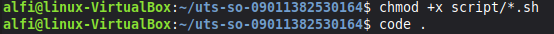
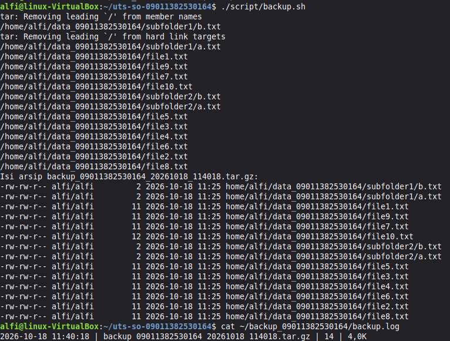
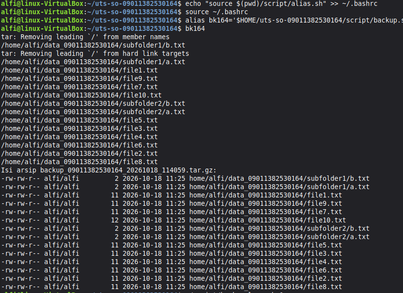
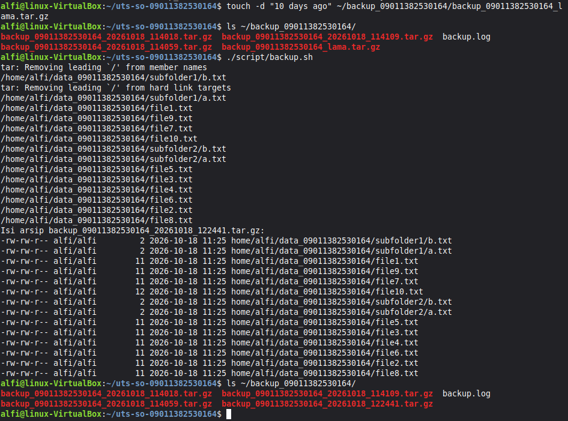
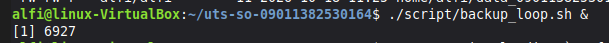
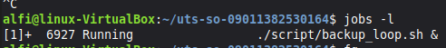
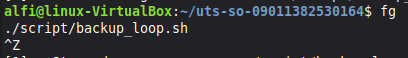
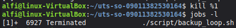
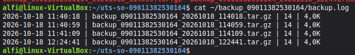

# Tugas Besar UTS Sistem Operasi - Backup Otomatis dengan Shell Script

## 1. Identitas

| Keterangan | Isi |
|---|---|
| Nama | M.Alfizahrin Ramadhan Daulay |
| NIM | 09011382530164 |
| Kelas | Sistem Komputer |
| Mata Kuliah | Sistem Operasi |
| Dosen | Iman Saladin B Azhar |

## 2. Deskripsi Program

Program ini melakukan backup otomatis terhadap seluruh file `.txt` di dalam folder `~/data_09011382530164` (termasuk subfolder).

Script yang dibuat:

| Script | Fungsi |
|---|---|
| `script/backup.sh` | Mencari file `.txt` dengan `find`, mengarsipkan dan mengompresi dengan `tar` + `gzip` menjadi `backup_09011382530164_<timestamp>.tar.gz`, memverifikasi isi arsip, lalu mencatat hasilnya ke `backup.log` |
| `script/backup_loop.sh` | Menjalankan `backup.sh` berulang setiap 60 detik (dipakai untuk demonstrasi job control di background) |
| `script/alias.sh` | Mendefinisikan alias `bk120` sebagai jalan pintas untuk menjalankan `backup.sh` |

Lokasi penting:
- Folder sumber : `~/data_09011382530164`
- Folder backup : `~/backup_09011382530164`
- File log      : `~/backup_09011382530164/backup.log` (format: `waktu | nama arsip | jumlah file | ukuran`)

Struktur repositori:

```
uts-so-09011382530164/
├── README.md
├── images/
└── script/
    ├── backup.sh
    ├── backup_loop.sh
    └── alias.sh
```

## 3. Cara Menjalankan

### 3.1 Persiapan data uji

```bash
mkdir -p ~/data_09011382530164/subfolder1 ~/data_09011382530164/subfolder2
cd ~/data_09011382530164
for i in $(seq 1 10); do echo "isi file $i" > "file$i.txt"; done
echo x > catatan.md; echo x > foto.jpg
for s in subfolder1 subfolder2; do echo a > $s/a.txt; echo b > $s/b.txt; done
```


### 3.2 Memberi izin eksekusi

```bash
cd ~/uts-so-09011382530164
chmod +x script/*.sh
```



### 3.3 Menjalankan backup.sh

```bash
./script/backup.sh
cat ~/backup_09011382530164/backup.log
ls ~/backup_09011382530164/
```




### 3.4 Menggunakan alias

```bash
echo "source $HOME/uts-so-09011382530164/script/alias.sh" >> ~/.bashrc
source ~/.bashrc
bk120
```



### 3.5 Menjalankan backup_loop.sh

```bash
./script/backup_loop.sh &
```

## 4. Fitur Pengembangan: Rotasi Arsip

Fitur yang dipilih adalah **rotasi arsip lama**. Di akhir `backup.sh` ditambahkan satu perintah yang menghapus arsip backup yang umurnya lebih dari 7 hari agar folder backup tidak terus membesar:

```bash
find "$BACKUP_DIR" -name "backup_*.tar.gz" -mtime +7 -delete
```

- `-name "backup_*.tar.gz"` : hanya menyasar file arsip hasil script ini.
- `-mtime +7` : file yang terakhir dimodifikasi lebih dari 7 hari lalu.
- `-delete` : menghapus file yang cocok.



## 5. Bukti Job Control

Langkah demonstrasi `backup_loop.sh` sebagai background job:

**a. Menjalankan di background (`&`)**

```bash
./script/backup_loop.sh &
```



**b. Melihat daftar job (`jobs -l`)**

```bash
jobs -l
```



**c. Membawa ke foreground (`fg`) lalu menghentikan sementara (`Ctrl+Z`)**

```bash
fg
# tekan Ctrl+Z
```



**d. Melanjutkan di background (`bg`)**

```bash
bg
jobs -l
```


**e. Menghentikan job (`kill`)**

```bash
kill %1
jobs -l
```



**f. Bukti log bertambah selama loop berjalan**

```bash
cat ~/backup_09011382530164/backup.log
```



## 6. Kendala dan Troubleshooting

<!-- Isi dengan kendala nyata yang kamu alami saat mengerjakan. Contoh format: -->

| No | Kendala | Penyebab | Solusi |
|---|---|---|---|
| 1 | Kesulitan Mengerjakan menggunakan nano | tidak terbiasa menulis kode di nano | Menggunakan Software |
| 2 | Kurang memahami Shell | Awam dalam Linux | Meminta bantuan AI untuk membuat Shell Script Beserta Penjelasannya yang bisa saya pelajari |